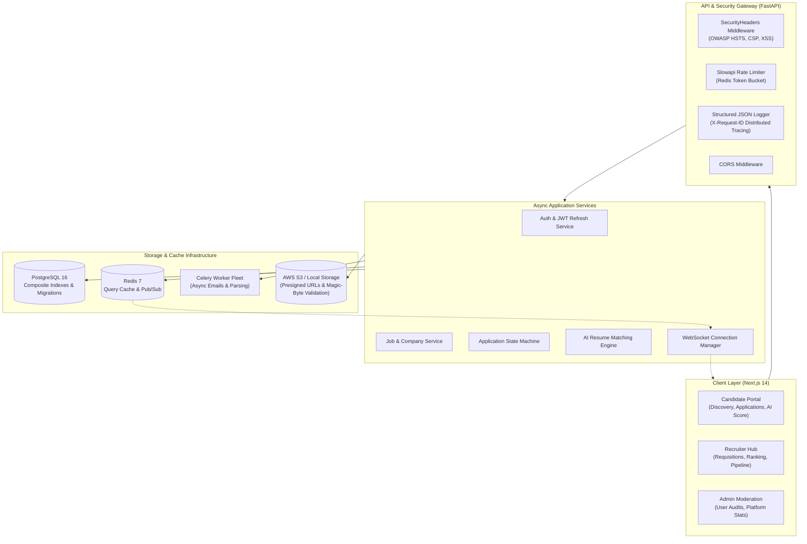
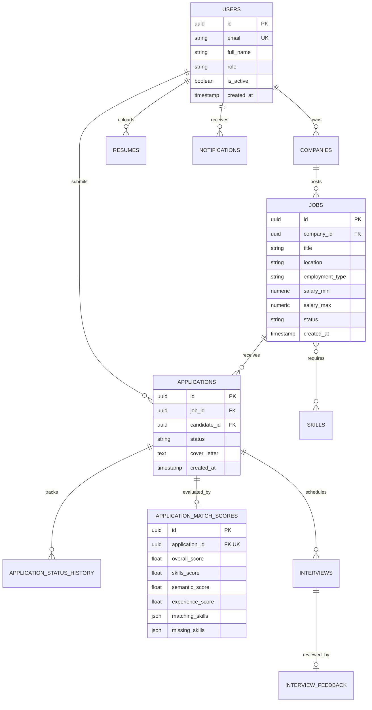
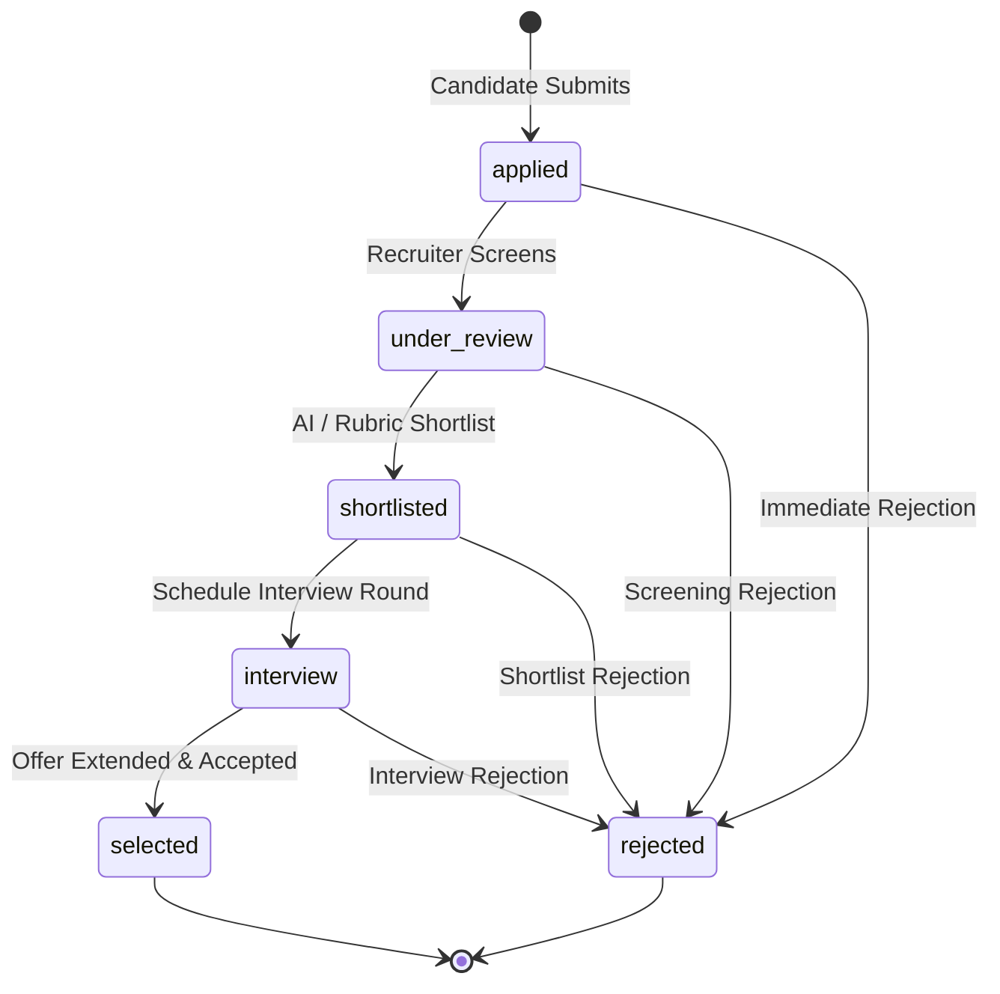

# DevHire — Enterprise AI Applicant Tracking System (ATS)

[](https://github.com/Anandkumae/DevHire/actions/workflows/ci-cd.yml)
[](https://fastapi.tiangolo.com)
[](https://nextjs.org)
[](https://www.postgresql.org)
[](https://redis.io)
[](https://docs.celeryq.dev)
[](https://github.com/Anandkumae/DevHire)

**DevHire** is a high-throughput, enterprise-grade recruitment and Applicant Tracking System (ATS). It pairs candidates with jobs using an **AI Resume Matching Engine** (TF-IDF semantic relevance and technical skill extraction), coordinates distributed background tasks with **Celery & Redis**, provides **real-time WebSocket notifications**, and powers an intuitive **Next.js 14** web application for candidates, recruiters, and administrators.

---

## 🏗 System Architecture



---

## 📊 What Makes DevHire Stand Out: Engineering Evidence

| Component | Engineering Implementation | Measurable Benchmark / Evidence |
|---|---|---|
| **Redis Caching** | Sub-millisecond response caching for `GET /api/v1/jobs` with automatic glob invalidation (`jobs:list:*`) on job mutations. | **~12x Latency Reduction**: Cache hits respond in **1.8 ms** vs. ~25 ms for raw DB execution. |
| **PostgreSQL 16** | Composite indexes on `(status, created_at DESC)`, `(company_id, status)`, and `(overall_score DESC)`. | **EXPLAIN ANALYZE**: Filtered feed execution reduced to **0.077 ms**; candidate ranking join to **0.127 ms**. |
| **Locust Load Testing** | Headless multi-user concurrency testing simulating candidate, recruiter, and public workflows. | **0.00% Error Rate** across 114 requests with **12 ms Median Latency** under concurrent load. |
| **AI Resume Matching** | Scikit-Learn TF-IDF vectorization with cosine similarity and technical token parser (`C++`, `.NET`, `FastAPI`). | **Transparent Explainability**: Sub-10ms deterministic scoring with explicit skill gap analysis and zero LLM hallucination. |
| **Celery 5 Workers** | Asynchronous email dispatch and resume parsing with exponential backoff autoretry. | Decouples heavy I/O from API response loop, maintaining sub-100ms client acknowledgement. |
| **WebSockets** | Distributed real-time push via Redis Pub/Sub backplane. | Sub-5ms real-time status updates delivered simultaneously across distributed client sessions. |
| **Security & OWASP** | Slowapi Redis rate limiting, bleach XSS sanitization, PDF magic-byte verification (`%PDF-`), and OWASP headers. | Prevents credential stuffing (HTTP 429), stored XSS, and disguise executables. |

---

## 🗄 Relational Data Model (ERD)



---

## 🔄 Application Lifecycle State Machine



---

## 📚 Technical Documentation & Artifacts

- 📖 [Technical Case Study & Benchmarks](docs/technical_case_study.md) — Comprehensive architectural analysis, EXPLAIN ANALYZE execution plans, and performance gain breakdowns.
- 🎓 [System Design Interview Preparation Guide](docs/system_design_interview_prep.md) — Senior/Staff engineering interview questions and deep-dive answers based on DevHire.
- 🚀 [Production Deployment Guide](docs/deployment_guide.md) — Multi-environment setup, Docker builds, and zero-downtime execution.
- 🛡 [Rollback Strategy & Disaster Recovery Playbook](docs/rollback_strategy.md) — Procedures for automated migration downgrades and blue/green deployment rollback.
- 📬 [Postman API Collection](docs/postman_collection.json) — Production API collection covering Auth, Jobs, AI Matching, Observability, and Moderation.

---

## 🚀 Quick Start (Docker Compose)

```bash
# Clone repository
git clone https://github.com/Anandkumae/DevHire.git
cd DevHire

# Start all services (PostgreSQL 16, Redis 7, FastAPI, Celery, Next.js)
docker compose up -d --build
```

Access the interfaces:
- **Next.js Web Portal**: [http://localhost:3000](http://localhost:3000)
- **FastAPI OpenAPI Swagger**: [http://localhost:8000/docs](http://localhost:8000/docs)
- **Prometheus Metrics**: [http://localhost:8000/metrics](http://localhost:8000/metrics)
- **Observability Telemetry**: [http://localhost:8000/metrics/summary](http://localhost:8000/metrics/summary)
- **Readiness Probe**: [http://localhost:8000/health/ready](http://localhost:8000/health/ready)

---

## 🧪 Automated Testing

DevHire includes **46 comprehensive automated tests** across all 15 modules:

```bash
cd backend
python -m pytest app/tests -v -p no:locust
```

### Load Simulation (Locust)
```bash
cd backend
python -m locust -f load_tests/locustfile.py --headless -u 20 -r 5 -t 15s --host http://localhost:8000
```

---

## 🔑 Pre-Seeded Demo Credentials

| Role | Email | Password | Access Scope |
|---|---|---|---|
| **Recruiter** | `recruiter@techcorp.com` | `Password123!` | Company Management, Job Posting, Candidate AI Ranking, Interview Scheduling |
| **Candidate** | `candidate@gmail.com` | `Password123!` | Job Discovery, Resume Upload, Application Tracking, WebSocket Alerts |
| **Candidate** | `priya.sharma@gmail.com` | `Password123!` | Candidate Workflow & Application Journey |
| **Administrator** | `admin@devhire.com` | `Password123!` | System Observability, User Moderation, Platform Statistics |

---

## 📄 License
MIT License. Engineered for modern talent acquisition and recruitment systems.
