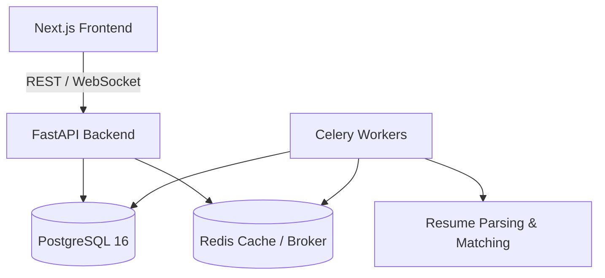

# DevHire System Architecture

## Overview
DevHire is designed as a distributed, scalable platform that matches candidates to job positions using modern asynchronous processing and AI.

## Core Components
- **Frontend**: Next.js 14+ App Router, TypeScript, Tailwind CSS.
- **Backend**: FastAPI with async SQLAlchemy, asyncpg connection pooling.
- **Cache & Message Broker**: Redis 7.
- **Background Tasks**: Celery for asynchronous PDF parsing and AI matching.
- **Database**: PostgreSQL 16 with Alembic for version-controlled migrations.
- **Deployment**: AWS (EC2, ECS, ECR, RDS, S3, CloudWatch) managed with Docker.
